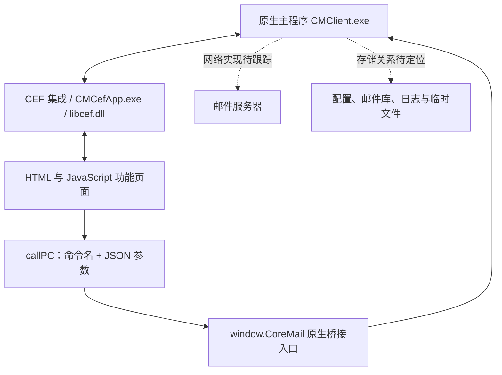

# Coremail / 浪潮邮箱客户端：整体结构初步梳理

检查日期：2026-10-15。方式：本机只读静态检查。本文区分直接证据与推断；不包含邮件正文、账户凭据或用户日志内容。

## 1. 对象与版本

| 对象 | 位置 | 证据与结论 |
| --- | --- | --- |
| 提供的安装包 | `D:\workspace\redocoreemail\cmclient_inspur_4.2.0-1062_amd64.exe` | 文件版本资源为 `4.2.0.1062`，产品名 `INSPURCMClient`，大小 104,651,168 字节 |
| 当前程序 | `C:\Program Files\cmclient` | 运行中 CMClient 进程路径与此一致；卸载注册项显示 `Coremail邮箱客户端软件V4.0`、版本 `4.2.1.1421` |
| 用户数据 | `C:\Users\wangbiao\AppData\Roaming\Cm\CMClient` | 包含 conf、logs、mail、temp |

安装包与已安装程序版本不同，后续应分别分析。此次主要检查当前安装版本，没有执行或解包安装器。安装版本号来自卸载注册项，未据此证明每个文件均为该版本。

## 2. 总体架构

**确认：原生主程序与嵌入式网页组成混合客户端。** `CMClient.exe` 和 `CMCefApp.exe` 均为 x64 PE，均导入 `libcef.dll`，无 CLR 头。主程序约 40.8 MB，CEF 库约 194.9 MB。

**高度支持的推断：主程序采用 C/C++ 与 wxWidgets 相关组件。** 主程序内存在 wxWidgets、wxWindow、Boost 相关字符串。尚未通过反编译确定每个原生模块及 UI 组件。

未在本次安装目录搜索中发现 ASAR 或 package.json；目前证据支持 CEF 原生集成，没有证据将它归为 Electron。

`libcef.dll` 版本资源报告 `109.1.18+gf1c41e4+chromium-109.0.5414.120`。这只是组件版本识别，本次没有做漏洞验证。

## 3. 可直接研究的界面模块

根目录：`C:\Program Files\cmclient\app\template`。

| 模块目录 | 可见职责或入口 |
| --- | --- |
| readMail | 会话与邮件正文展示、附件操作、快速回复、打印、日程邮件、加密邮件和 AI 面板 |
| compose | 写信、回复、签名、富文本编辑；存在 KindEditor 相关资源 |
| calendar / smallCalendar | 日历与日期选择；存在 FullCalendar、Moment 相关脚本 |
| bookmeeting | 会议创建、会议室与成员忙闲查询 |
| recurrence | 重复日程规则 |
| card | 卡片页面，具体运行用途待确认 |
| encrypt | 加密相关页面资源 |
| ai / lib/cmAI | AI 交互页面与公共组件 |
| utils / lib | 原生调用、快捷键、剪贴板、水印、公共库等 |

目录和脚本存在不代表当前账户开通了对应功能。主窗口、账户管理、网络同步等完整逻辑并不都在这些网页资源中。

阅读页 `app\template\readMail\index.html` 第 718–738 行展示其资源依赖：本地化脚本、公共工具、jQuery、模板库、callPC 桥接脚本、阅读页入口等。

## 4. JavaScript 与原生程序的边界

可读证据：`app\plugin\webview\plugin.js`。

- 第 1–9 行：将参数转成 JSON，并调用 `window.CoreMail(funcName, strArgs)`；另一分支使用 `CoreMail.postMessage`。
- 第 15–28 行：注册并分发回调。
- 第 31–50 行：暴露 close、getAttributes、callFunc 包装。
- `app\template\utils\callPC.js` 中存在相同方向的调用封装。

用静态正则从 21 个非 vendor JS 文件中提取到 **81 个不同的字面量 callPC 命令名**。这是下限：动态构造的命令、其他包装和原生侧注册表未覆盖。

| 功能 | 已发现的命令示例 |
| --- | --- |
| 阅读邮件 | ready、readMailHadLoaded、showMailDetail、quickReply |
| 附件 | attachmentDownload、attachmentStartDrag、copyAttachments、openAttachment |
| 写信 | sendcompose、getHtmlAndTextSrc、dropfiles、insertSignature |
| 日历与会议 | addNewSchedule、createMeeting、queryMemberBusyInfo |
| 加密与证书 | DecryptMail、SaveCert、ViewCert |
| AI | aiCall、aiCancel、needAISetting |
| 跟踪数据相关 | getTrackingData、uploadTrackData |

这些名称是程序内部桥接命令，不能视为邮件服务器 HTTP API，也未证明它们能从外部进程直接调用。跟踪命令的存在不证明当前正在上传数据。

完整提取结果见同目录 `structure.json` 的 `bridge_commands`。

## 5. 收发邮件与加密组件线索

主程序中发现 IMAP、SMTP、POP3 相关符号或文案，以及 `/coremail/XT3/`、`/coremail/XT5/` 字符串。由此可确认这些协议或接口相关代码线索存在，但不能据此判断当前账户使用哪种模式。

安装目录中存在 `gmssl.dll`、`legacy.dll`，主程序中也有 OpenSSL、GmSSL 相关字符串。要确认登录认证、TLS、国密或邮件加密实际使用哪条链路，还需跟踪调用关系。

`app\conf\privatization-setting.js` 明确包含 `customer_type: inspur.com` 与 `key: inspur-setting`，支持其为浪潮定制配置的判断。

## 6. 本地数据结构

扫描时数据目录的汇总如下；客户端仍在运行，数量和大小可能变化。

| 目录 | 文件数 | 大小约 | 已知情况 |
| --- | ---: | ---: | --- |
| conf | 5 | 7 KB | 用户设置、快捷键、GUI 配置、代理数据等 |
| logs | 71 | 50.0 MB | 日志及轮转文件；本次未读取日志内容 |
| mail | 1 | 208 字节 | 一个 sdat 文件，未确定编码和用途，未发现明文存储路径 |
| temp | 2,214 | 353.5 MB | 页面、图片、附件格式与缓存等混合文件 |

**后续已定位账户存储目录：`D:\work\email\wangbiao@inspur.com`。** 用户提供了路径，实际检查确认包含 mail.edbx2、mails、archmails 和 search。下表仅描述 Roaming 目录，不代表全部邮件数据。账户存储的完整初查见同目录 `邮件存储结构.md`。

在部分非正文候选文件中只读取前 16 字节，识别到 temp 下 5 个具有标准 SQLite 3 文件头的文件。尚未读取表结构，不能将它们认定为邮件库，可能属于浏览器缓存或其他组件。

主程序存在 `SQLite3 Multiple Ciphers 2.0.2` 字符串，并附带 `toolkits\sqlite3mc_shell.exe`。这支持存在 SQLite 加密组件；未证明当前邮件库的加密状态、算法或密钥。`.enc` 与 `.att` 扩展名也不足以确定实际文件格式。

## 7. REA 的接入与适合的分析路线

本机 Node.js 为 v24.19.0、npm 为 11.17.0。首次尝试通过 npx 获取 REA 时遇到 ENOTCACHED 与 ECONNREFUSED，本文最初证据来自 PowerShell、文件静态读取和 Python pefile。**后续用户授权接入后已完成 REA 6.5.0 的 Codex 配置、独立 MCP 握手与网页资源静态分析**，详见同目录 `REA接入状态.md`。原生反编译引擎尚未配置。

接入 REA 后可采用两条路线：

1. 对 `C:\Program Files\cmclient\app` 做 JavaScript 应用静态分析，进一步跟踪阅读、写信、附件等模块与桥接调用。该分析只覆盖网页部分。
2. 使用 Ghidra 或 IDA 分析 `CMClient.exe`，从 CoreMail 桥接注册入口和上述命令字符串查交叉引用，定位原生业务分发、网络协议与数据库模块。Windows Ghidra 集成在 REA 文档中标为实验性。

真实账户存储目录已在后续检查中定位。接下来最有价值的顺序：确认元数据与正文/附件的关系 → 跟踪桥接到原生实现 → 确认账户实际使用的协议 → 再按具体功能做动态验证。

## 8. 证据文件与边界

- `structure.json`：组件哈希、PE 导入、框架关键词计数、网页模块体量、桥接命令、数据目录汇总和 SQLite 文件头匹配。
- `..\inspect_client.py`：只读结构检查脚本；使用本机已有的 pefile。运行时只在工作区写结果。
- 主程序 SHA-256：`a2cc47c5efb74524dd82e447204d0cc9587a971f9cda9552187eee19abb37c5b`。
- 安装包与主程序的签名对象显示签署者为广东盈世计算机科技有限公司，但系统返回 `UnknownError`；此次未确认签名链验证成功。

本次未执行安装包、未修改程序和配置、未调用桥接、未抓包、未发送邮件。没有完成原生反编译或数据库格式还原，因此本文属于整体结构静态初查，不是完整源码或协议审计。
