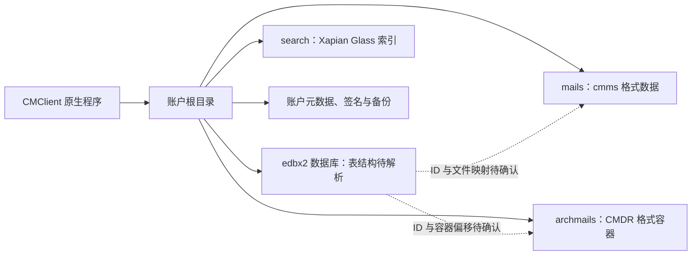

# 邮件账户存储结构

检查日期：2026-10-15。账户根目录：`D:\work\email\wangbiao@inspur.com`。

以下来自目录枚举、文件大小、短文件头和程序字符串检查。没有读取邮件正文、附件内容、账户凭据或安全配置，没有修改账户文件。客户端仍在运行，统计值是检查时快照。

## 已发现的分层

| 文件或目录 | 检查时大小 | 判断与证据 |
| --- | ---: | --- |
| mail.edbx2 | 21.40 MB | 名称指向邮件数据库，具体表结构与记录内容尚未解析 |
| address.edbx2 | 40.30 MB | 名称指向通讯录数据库，具体表结构尚未解析 |
| calendar.edbx2 | 40.96 KB | 名称指向日历数据库，具体表结构尚未解析 |
| setting.edbx2 | 77.82 KB | 名称指向设置数据库，具体表结构尚未解析 |
| mails | 517.29 MB | 456 个 .data 文件；全部以 ASCII `cmms`（636d6d73）开头 |
| archmails | 5,564.29 MB | 256 个 .cmpack 文件；全部以 ASCII `CMDR`（434d4452）开头 |
| search | 182.96 MB | 5 个文件，其中 3 个 .glass；一个辅助文件头包含 `Xapian Glass` |
| backup | 681.89 KB | 5 个 gzip 文件、1 个 .edbx2 文件 |
| backup_second | 0 | 目前为空 |
| signature | 10.03 KB | HTML、PNG、DAT 格式签名资源；未读取其内容 |
| account.sdat / security.sdat | 656 / 320 字节 | 名称提示账户与安全元数据，未解析内容 |

大小使用十进制 MB/KB。`.cmpack` 和 `.data` 的文件数量不能解释为邮件封数，一个容器可能存储多条记录。

## 数据库格式

根目录四个 .edbx2 的前 16 字节完全一致：

`d82bd87570929bb1967e21e1982e7228`

它们不具有标准明文 SQLite 文件头，文件大小均为 4096 的整数倍。附带的 .edbx2 备份也具有相同文件头。

结合主程序内 `SQLite3 Multiple Ciphers 2.0.2`、`sqlcipher` 和 `select encrypted file (*.edbx2 *.edb or *.sdat file)` 字符串，以及随附的 sqlite3mc 工具，**有证据支持这些数据库使用加密或专有封装**。但没有确认它们具体采用哪种算法、页面布局、密钥来源或是否存在额外文件头。4096 对齐也不能单独证明内部页大小就是 4096。

因此本次未将 .edbx2 直接交给普通 SQLite 读取，也没有获取表结构。不能将它们重命名为 .db 就假定可正常打开。

## 正文与归档容器

**确认是两类不同格式的文件：** 所有 .data 的四字节标记均为 `cmms`；所有 .cmpack 均为 `CMDR`。抽样文件头均非 SQLite、ZIP 或 GZIP 的标准起始标记。

目录命名支持“mails 为邮件数据、archmails 为归档邮件数据”的推断，但尚未证明：

- .data 与 .cmpack 的转换或迁移规则；
- 一个文件对应一封还是多封邮件；
- 正文与附件是一起封装还是分开保存；
- 数据库中的邮件 ID 如何映射到容器、偏移和长度；
- 容器内部是否压缩、加密或包含可直接导出的 MIME 内容。

## 全文搜索

搜索目录中的辅助文件带有 `Xapian Glass` 格式标记，主程序存在 XapianReader、Xapian::BM25Weight 等字符串。两者共同支持该目录为 Xapian Glass 搜索索引。

这确认了搜索索引技术，但尚未检查字段定义、索引覆盖范围以及能否从索引恢复正文。搜索索引应与原始邮件数据分开理解。

## 备份

抽样 .gz 文件具有正确的 GZIP 标记。只通过 gzip 读取了一个样本的前 16 个解压字节，发现类似 CSV 列头的标记；未解压完整文件或读取记录。因此不将 backup 目录直接认定为完整邮件备份，也不能认为仅复制它即可恢复全部邮件。

## 修正后的数据关系

## 下一步分析入口

优先从 CMClient.exe 中 `.edbx2`、`.cmpack`、`archmails` 和 SQLite3 Multiple Ciphers 相关字符串查交叉引用，识别数据库打开函数和容器读写函数。再梳理邮件 ID、正文、附件的映射，并用客户端导出的一封测试邮件交叉验证。

可复核材料：同目录 `storage-structure.json`；工作区根目录 `inspect_storage.py`。报告中的全量四字节标记一致性与程序字符串核对来自本次单独的只读检查，脚本 JSON 保存目录统计和抽样文件头。
