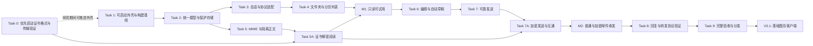

# Coremail V0.1 开发实施计划

> **For agentic workers:** REQUIRED SUB-SKILL: Use superpowers:subagent-driven-development (recommended) or superpowers:executing-plans to implement this plan task-by-task. Steps use checkbox (`- [ ]`) syntax for tracking.

**Goal:** 交付一套可在 Windows 安装试用的单账号 Coremail 图形客户端，可靠完成普通邮件的浏览、阅读、纯文本写信、回复、正文转发、本地草稿恢复及个人证书加密发送、解密阅读，与原客户端互通。

**Architecture:** 使用 Python + PySide6 / Qt Widgets 构建三栏工作台；Qt WebEngine 只承担隔离后的 HTML 正文阅读。独立账号 worker 持有 Coremail HTTPS 会话，应用服务组织读取、草稿和发送状态；UI 不直接接触 sid 或拼接协议。现有 `probe/` 保留为连接验证工具，生产逻辑按接口和测试迁移。

**Tech Stack:** Python 3.12；PySide6 / Qt Widgets / Qt WebEngine；标准库 MIME、SQLite 与 HTTPS；Windows 用户级 DPAPI；`unittest` 与 QtTest。PySide6 与打包工具版本在 Task 1 的 Windows 构建验证后锁定。

**Spec:** [客户端设计文档](../specs/2026-10-15-coremail-desktop-design.md)

状态：计划待评审；本次只生成计划，不安装产品依赖或开始产品实现。

2026-10-15 调整：用户要求证书加解密提前。新增 Task 0、5A、7A，保留原任务编号；共 12 项任务。证书格式和传输契约验证先行，解密进入 M1，加密发送互通进入 M2，均为完整 V0.1 发布条件。

## Global Constraints

以下约束沿用设计稿，所有任务均须遵守：

- Windows 单账号优先，三栏工作台；纯文本写信先行。
- 已读状态以服务器值显示，V0.1 不自动回写已读标记；V0.2 验证接口后提供同步切换。
- 不提供离线发信、批量自动操作、自动规则或定时发送。
- 不修改原客户端安装目录，也不写入或迁移现有 `.edbx2`、`.data`、`.cmpack` 数据库和容器。
- 默认不做“记住密码”；后续如需要，单独设计 Windows 凭据存储与账号退出语义。
- 服务器 composeId 不能被假定为具备幂等保证。
- 以已认证接口成功作为登录成功证据，进入工作台。
- 正文页面不挂载 QWebChannel 或其他业务桥接，不拥有登录 CookieJar，不加载应用配置或密钥。
- 当前真实兼容基线是 `https://newmail.inspur.com/coremail/`，不混用 Outlook OWA。
- 所有新网络、MIME 与磁盘工作离开 UI 线程；每账号一个会话 worker 串行持有会话。
- 集成测试使用明确的测试内容与收件人；不自动发送给原邮件中的第三方。

## Review Focus

重点审查以下六种容易漏掉的输入与故障，并在对应任务落实测试：

1. 快速切换文件夹/邮件时旧请求晚到：旧结果不能覆盖当前视图（Task 3、4）。
2. 恶意 HTML、CID、CSS URL 与本地路径：正文不能外连泄露会话或访问任意文件（Task 5）。
3. 回复全部中的别名、Reply-To、重复地址和原 Bcc：正确去重、不暴露密送（Task 6）。
4. 已提交发送但响应丢失或客户端崩溃：恢复为 Unknown，不自动重发（Task 7）。
5. 本地磁盘写入失败、DPAPI 解密失败与草稿版本竞争：不误报保存成功、不覆盖较新草稿（Task 2、6）。
6. 证书用途/邮箱不符、缺少收件人证书、密码错误和未知格式：不能误报解密成功或静默明文发送；加解密互通不能只靠自产样本（Task 0、5A、7A）。

---

## 1. 第一版开发什么

### 1.1 用户可使用的功能

| 功能 | V0.1 交付行为 | 验收方式 |
| --- | --- | --- |
| 登录 | 本应用独立密码登录；清楚显示网络、认证与会话失效状态 | 新会话登录并成功调用文件夹接口 |
| 邮件工作台 | 中文三栏：文件夹、邮件列表、阅读区；可调整栏宽 | 切换文件夹、恢复选中位置，窗口缩放可用 |
| 列表与刷新 | 每页 50 条、继续加载、手动刷新、已加载列表筛选 | 不重复、不丢选择、不把局部筛选称为全邮箱搜索 |
| 阅读 | 纯文本、受限 HTML、中文编码、引用内容、附件描述 | MIME 样本及真实普通邮件可阅读 |
| 证书解密 | 本机选择 PFX、解锁/锁定、识别实际加密格式、解密后阅读 | 原客户端生成的加密测试邮件可读，错误及签名/信任状态区分清楚 |
| 证书加密发送 | 显式配置收件人公开证书，检查 To/Cc/Bcc 及发件人副本 | 新实现生成的加密邮件可由原客户端解密；缺证阻止发送，不自动降级 |
| 新建与发送 | 收件人、抄送、密送、主题、纯文本正文 | 固定测试邮件真实发送并收回 |
| 回复与转发 | 回复、回复全部、转发正文；保留正确引用关系 | 使用受控测试邮件核对地址与 MIME 头 |
| 本地草稿 | 编辑停止约 1 秒后保存、Ctrl+S、重启恢复 | 强制退出后恢复；磁盘不出现明文草稿 |
| 发送反馈 | 校验、准备、提交、接受、失败、结果待确认 | 连点与断网不产生自动重复发送 |
| 桌面运行 | Windows 启动包、基础设置、快捷键、错误状态 | 干净用户环境启动与完整操作验收 |

### 1.2 第一版明确不做

实际附件上传、下载和预览；读写已读/星标、移动和删除；服务端全量搜索；离线邮件库；后台实时推送；多账号；富文本编辑；独立签名发送工作流（实际加密格式要求的签名除外）；组织通讯录；日历与 AI 功能。

附件先展示名称、类型和大小；转发入口标为“转发正文”。已确认目标格式必须支持解密，其他格式显示具体不支持状态。加密信封的拉取/提交属于首版协议工作，不等同于开放普通附件下载或上传入口。未实现能力不得用看似可操作的按钮占位。

### 1.3 开发顺序和交付节点



M1 与 M2 是中间试用版本，不代表 V0.1 全部完成。当前没有测量开发工时，计划按可验收结果推进，不给未经验证的日期承诺。

## 2. 文件与模块安排

所有路径相对于项目根目录 `D:\workspace\redocoreemail`。

```text
coremail_desktop/
  __init__.py / __main__.py / bootstrap.py    启动与依赖组合
  models.py / errors.py                      公共不可变模型、错误分类
  protocol/coremail.py                       登录与业务协议
  session/worker.py / controller.py           会话所有权、后台任务、UI 事件
  mailbox/service.py / list_model.py          分页、合并、选择与筛选
  mime/parser.py / sanitizer.py               MIME 解析与 HTML 净化
  crypto/service.py / backend.py / recipients.py  证书生命周期、格式后端与收件人公钥检查
  reader/view.py / resources.py               独立 WebEngine 与 CID 资源
  compose/service.py / recipients.py          编辑、引用语义和收件人
  drafts/store.py / autosave.py               本地草稿、修订与恢复
  outbox/service.py / journal.py              发送状态机与持久化发送意图
  storage/dpapi.py / preferences.py           Windows 保护、界面偏好
  ui/main_window.py / login_dialog.py         主工作台与登录
  ui/mail_list.py / composer.py / theme.py    列表、编辑器、主题
packaging/
  desktop.spec / build.ps1                    Windows 构建配置
tests/
  fixtures/                                  小型合成 MIME/协议样本
  test_desktop_*.py                           生产模块测试
probe/                                       保留现有验证工具
```

`models.py` 只保存稳定的数据接口，不放协议、Qt 控件或存储逻辑。各业务文件以可独立测试为拆分边界；执行时不为不存在的功能提前建立空模块。

当前工作区不是 Git 仓库。执行 Task 1 时先检查最新工作区状态；若用户尚无版本库，在项目内初始化本地仓库并配置忽略规则。计划中的“提交检查点”仅适用于该本地版本库，不意味着推送远程或创建 PR。

## 3. 任务清单

每个任务按红测试 → 最小实现 → 绿测试 → 验收/评审 → 本地提交检查点执行。以下测试名称、断言和接口是约束，正文不预写实现。

### Task 0：前置验证 PFX 用途、实际加密格式与提交契约

**Files**
- Create：`analysis/certificate-compatibility.md`、`tools/research/crypto_probe.py`。
- Test：`tests/test_crypto_probe.py`、`tests/fixtures/crypto/`（仅合成证书与无业务内容样本）。个人 PFX、私钥、原始公司邮件不提交仓库。

**Interfaces**
- 探针提供 `inspect`、`decrypt`、`encrypt` 三种显式子命令；证书密码只在本机遮蔽输入，不通过命令行参数传递。
- 报告必须记录：证书用途与身份结论、目标 MIME/企业封装格式、算法及库、信任校验策略、收件人证书来源、加密载荷获取/提交契约、双向互通结果及未验证项，不输出私钥、密码或正文。

- [ ] 1. 使用合成 PFX 和消息编写密码错误、身份/用途不匹配、未知格式、加解密基本往返及输出脱敏测试；未知格式必须失败，不能猜测为 S/MIME。
- [ ] 2. 运行 `python -m unittest discover -s tests -p test_crypto_probe.py -v`，确认尚未实现的探针失败。
- [ ] 3. 核对本机公开证书属性和受控加密测试邮件，选用成熟密码后端，不自行实现算法。证书密码不保存，私钥不导出明文临时文件。验证读取完整信封及原样提交加密载荷的路径；普通 compose 成功不能代替该证据。
- [ ] 4. 验证原客户端加密→探针解密、探针加密→原客户端解密及自发自收；核对 To/Cc/Bcc、发件人可解密副本及必要签名封装。真实测试仅使用自身或另行明确的测试收件人；缺证或无真实样本时如实记录阻塞项，不能称为已兼容。
- [ ] 5. 保存脱敏兼容报告和合成回归样本，提交 `docs: establish certificate encryption compatibility contract`。Task 0 的真实双向验证未通过前，不锁定产品后端或声称加密能力完成；普通邮件任务可继续交付预览版。

**独立交付：** 可复验的格式/协议/后端决策；不是完整产品。实际证书与样本仍待执行阶段本机验证。

### Task 1：可启动桌面外壳与 Windows 构建基线

**Files**
- Create：`coremail_desktop/__init__.py`、`__main__.py`、`bootstrap.py`、`ui/main_window.py`、`ui/theme.py`。
- Create：`pyproject.toml`、锁定依赖文件、`.gitignore`、`packaging/desktop.spec`、`packaging/build.ps1`。
- Test：`tests/test_desktop_shell.py`。

**Interfaces**
- Produces：`bootstrap.create_application(argv: list[str]) -> QApplication`。
- Produces：`MainWindow()`，只负责布局，后续通过 controller 注入服务。
- Produces：`python -m coremail_desktop` 与 Windows 构建脚本入口。

- [ ] 1. 编写 `test_shell_starts_without_connecting_network`：窗口能创建；构造和启动不发登录或邮件请求；初始三栏可见；最小窗口为 1000×680。
- [ ] 2. 运行 `python -m unittest discover -s tests -p test_desktop_shell.py -v`，确认缺少外壳实现导致失败。
- [ ] 3. 实现仅含静态空状态的外壳，设置设计稿语义主题、系统字体和可见焦点；安装并锁定经 Python 3.12/Windows 实测可用的 Qt 与打包依赖。忽略 `.tools/`、`.npm-cache/`、临时目录、个人证书、用户数据和运行产物。
- [ ] 4. 复跑测试；构建一次包含 Qt WebEngine 运行资源的启动包，在无开发环境的 Windows 用户上下文检查启动、正文空页面和退出。记录运行依赖、许可证与构建版本。
- [ ] 5. 提交 `chore: establish Windows desktop shell and build baseline`。若基础包不能启动，先修复，不进入邮件界面扩展。

**独立交付：** 可启动、可关闭、布局清楚的空工作台与可重复构建入口。

### Task 2：公共模型、DPAPI 保护与本地草稿存储

**Files**
- Create：`models.py`、`errors.py`、`storage/dpapi.py`、`storage/preferences.py`、`drafts/store.py`、`outbox/journal.py`。
- Test：`tests/test_desktop_storage.py`、`test_desktop_models.py`。

**Interfaces**
- `AccountConfig(local_id: str, origin: str, login_uid: str)`。
- `Folder(remote_id: str, name: str, role: str | None, counts: dict)`。
- `MessageSummary(remote_id: str, folder_id: str, subject: str, sender: str, date_text: str, flags: dict)`。
- `AttachmentInfo(part_id: str, name: str, media_type: str, size: int | None)`。
- `MessageDocument(remote_id: str, raw_digest: str, text: str, html: str | None, attachments: tuple[AttachmentInfo, ...], headers: dict[str, tuple[str, ...]])`。
- `DraftDocument(local_id: str, revision: int, mode: str, from_identity: str, to: tuple[str, ...], cc: tuple[str, ...], bcc: tuple[str, ...], subject: str, body: str, reference_headers: dict[str, str])`。
- `SendJob(local_id: str, draft: DraftDocument, compose_id: str | None, state: str, submitted_at: str | None)`。
- `DataProtector.protect(plaintext: bytes) -> bytes`；`unprotect(ciphertext: bytes) -> bytes`。
- `DraftStore.save(draft: DraftDocument) -> int`；`load(local_id: str) -> DraftDocument`；`list_ids() -> list[str]`。
- `SendJournal.persist(job: SendJob) -> None`；`recover() -> list[SendJob]`，权威记录包含整个冻结快照。
- `AppError(code: str, operation_id: str)` 不携带原始响应或认证 URL。

- [ ] 1. 编写测试：`test_draft_roundtrip_preserves_revision` 核对原文恢复；`test_persisted_content_has_no_plaintext_subject_body_or_recipients` 检查真实落盘字节；`test_stale_revision_cannot_replace_newer_draft` 拒绝旧修订；`test_write_failure_does_not_acknowledge_saved`；`test_unprotect_failure_keeps_original_record`。
- [ ] 2. 运行对应测试文件，确认接口缺失或行为未实现导致失败。
- [ ] 3. 实现用户级 DPAPI 封装、独立应用数据目录、原子加密记录写入与修订检查；只将本地 ID/修订/状态写入可重建索引。普通 SQLite 只保存非邮件偏好，不写明文主题/正文。
- [ ] 4. 复跑两个测试文件；增加 Windows 当前用户真实保护/解保护验证，以及写入过程中崩溃恢复记录的检查。
- [ ] 5. 提交 `feat: add protected drafts and durable send journal`。

**独立交付：** 不依赖网络即可测试的保护存储、崩溃恢复与稳定模型。

### Task 3：生产协议适配与账号 worker

**Files**
- Create：`protocol/coremail.py`、`session/worker.py`、`session/controller.py`、`ui/login_dialog.py`。
- Test：`tests/test_desktop_protocol.py`、`test_desktop_session.py`。
- 保留：`probe/` 和原有验证测试，不静默改变其用途。

**Interfaces**
- `CoremailAdapter.login(account: AccountConfig, password: str) -> None`。
- `get_account_identities() -> set[str]`：返回登录后确认的主地址及别名；无法确认的别名须由用户明确配置，不从登录名拼接推断。
- `list_folders() -> list[Folder]`；`list_messages(folder_id: str, offset: int, limit: int = 50) -> list[MessageSummary]`；`fetch_mime(message_id: str) -> bytes`。
- `create_compose(draft: DraftDocument) -> str`；`deliver(compose_id: str, draft: DraftDocument) -> dict`；`close() -> None`。
- `SessionController.submit(operation: str, params: dict, view_generation: int) -> str` 返回任务 ID。
- Qt 信号：`completed(task_id, view_generation, result)`、`failed(task_id, view_generation, app_error)`、`auth_required()`；不得传密码或 sid。

- [ ] 1. 测试迁移已验证的表单、同源 JS 跳转、ExtendedJSON、continue/deliver 和 MIME 错误识别；合成样本替换测试对 `analysis/web-login/public-login.html` 的依赖。新增 `test_worker_owns_session_on_one_thread`、`test_multiple_expired_requests_emit_one_auth_prompt`、`test_login_success_requires_authenticated_api`、`test_late_response_keeps_original_generation`。
- [ ] 2. 运行 `test_desktop_protocol.py`、`test_desktop_session.py`，确认失败。
- [ ] 3. 按 `analysis/protocol-feasibility.md` 与真实结果迁移适配器；使用 worker 串行持有网络会话。错误按网络/TLS/认证拒绝/挑战/解析/会话失效分类，只读请求最多 2 次额外重试，写操作与认证拒绝不自动重试。
- [ ] 4. 复跑测试，再用本机交互密码进行一次独立登录与只读接口验证；不读取既有 Chrome/客户端令牌。将部署能力与未支持挑战类型记录为结构化状态。
- [ ] 5. 提交 `feat: add isolated Coremail session worker and adapter`。

**独立交付：** UI 可以非阻塞登录、取得类型化文件夹和摘要；鉴权失效只产生一次恢复提示。

### Task 4：文件夹、分页邮件列表与局部筛选

**Files**
- Create：`mailbox/service.py`、`mailbox/list_model.py`、`ui/mail_list.py`。
- Modify：`ui/main_window.py`，接入 Task 3 的 controller。
- Test：`tests/test_desktop_mailbox.py`、`test_desktop_list_ui.py`。

**Interfaces**
- `MailboxService.merge_page(folder_id: str, summaries: list[MessageSummary], replace: bool) -> None`。
- `MessageListModel.set_folder(folder_id: str)`；`set_filter(text: str)`；`selected_message_id() -> str | None`。
- controller 提交的 operations：`list_folders`、`list_messages`；参数使用 Task 3 的签名。

- [ ] 1. 编写 `test_merge_deduplicates_remote_ids`、`test_refresh_preserves_selection_and_scroll`、`test_late_folder_page_cannot_replace_current_folder`、`test_filter_states_loaded_count`；UI 测试校验无结果文案为“已加载邮件中无匹配”，不会表述成全邮箱为空。
- [ ] 2. 运行两份测试，确认失败。
- [ ] 3. 实现每页 50 条、继续加载、F5 手动刷新、服务器计数显示和当前列表筛选；采用 Qt model/view，不为每封邮件创建独立控件。状态回写和删除操作不在本任务加入。
- [ ] 4. 复跑测试；用 1,000 条合成摘要验证滚动、选择和筛选；在真实账号进行文件夹切换和限量分页读取，记录覆盖范围。
- [ ] 5. 提交 `feat: add paged mailbox navigation and loaded-list filtering`。

**独立交付：** 可浏览真实文件夹和邮件摘要，刷新不丢位置。

### Task 5：MIME 解析、附件描述与隔离正文阅读

**Files**
- Create：`mime/parser.py`、`mime/sanitizer.py`、`reader/view.py`、`reader/resources.py`。
- Modify：`ui/main_window.py`，接入正文选择与阅读任务。
- Test：`tests/test_desktop_mime.py`、`test_desktop_reader.py`；`tests/fixtures/mime/` 合成样本。

**Interfaces**
- `parse_mime(message_id: str, raw: bytes) -> MessageDocument`。
- `sanitize_html(source: str, cid_resources: dict[str, bytes]) -> str`。
- `ReaderView.set_document(document: MessageDocument)`；`clear()`。
- `ReaderResourceStore.resolve(document_id: str, cid: str) -> bytes | None`，仅命中文档拥有的资源。

- [ ] 1. 编写纯文本/HTML/GBK与UTF-8/multipart/嵌套附件/缺失或重复 Message-ID 样本测试。新增 `test_script_event_and_css_urls_cannot_escape_reader`、`test_cid_is_scoped_to_current_document`、`test_file_url_and_remote_fetch_are_blocked`、`test_late_mime_result_does_not_replace_current_message`。
- [ ] 2. 运行 MIME 与 reader 测试，确认失败。
- [ ] 3. 实现后台 MIME 解析与受限 HTML 白名单净化；使用独立 WebEngine profile，无认证 cookie、无 QWebChannel、无脚本权限。请求拦截默认拒绝网络和任意 file://；正文外链只在用户明确点击后交给系统浏览器。V0.1 不提供远程图片下载开关，始终提示已阻止。
- [ ] 4. 使用固定限制测试资源预算：原始邮件初始上限 25 MiB、解码后内容总量 64 MiB、MIME 深度 30；超限保留摘要并显示原因，不卡死 UI。通过测试后，用真实普通邮件核对正文和附件描述，不保存实际正文到测试仓库。
- [ ] 5. 提交 `feat: add isolated MIME reader and attachment descriptions`。

### Task 5A：证书生命周期与加密邮件解密阅读

**Files**
- Create：`crypto/backend.py`、`crypto/service.py`、`ui/certificate_dialog.py`。
- Modify：`models.py`、`mime/parser.py`、`reader/view.py`、`bootstrap.py`、依赖锁文件及打包配置。
- Test：`tests/test_desktop_crypto.py`、`tests/test_desktop_crypto_reader.py`。

**Interfaces**
- `CryptoService.unlock(pfx_path: str, password: str) -> CertificateInfo`；`lock() -> None`。
- `CryptoService.decrypt(envelope: bytes) -> DecryptionResult`，结果包含内部 MIME、格式与单独的签名/信任状态；模型在此任务统一定义。
- `CertificateInfo` 仅包含指纹、邮箱集合、用途、有效期及信任结果等公开属性；私钥留在后台服务。`DecryptionResult` 包含 `mime_bytes`、`format`、`signature_status`、`trust_status`，原始明文不进入日志或持久缓存。
- 后端只允许 Task 0 确认的格式/算法，证书材料不进入 UI 正文容器或网络 worker。

- [ ] 1. 编写错误密码、不匹配私钥、未知算法、畸形信封、超限解密输出、锁定后不可再解密、解密 HTML 无业务权限等测试；检查诊断及临时目录无密钥/明文输出。
- [ ] 2. 运行 `python -m unittest discover -s tests -p 'test_desktop_crypto*.py' -v`，确认缺失行为失败。
- [ ] 3. 实现本地选择/解锁/锁定和后台解密；解密后 MIME 复用 Task 5 的大小、递归深度及 HTML 隔离限制。错误明确显示；解密成功不等于签名可信。退出或锁定清除视图与解密缓存，释放密钥引用，不声称 Python 内存可保证清零。
- [ ] 4. 测试通过后在图形界面读取原客户端生成的受控加密邮件；验证普通邮件不依赖证书解锁。干净 Windows 环境验证密码后端资源可用，私钥始终不上传。
- [ ] 5. 提交 `feat: add certificate unlock and encrypted message reading`。

**M1 验收：** 主工作台可登录、浏览、分页、刷新，阅读普通及目标格式加密邮件；无邮件写操作，HTML 不拥有业务权限。

### Task 6：纯文本编辑、地址语义与自动草稿

**Files**
- Create：`compose/service.py`、`compose/recipients.py`、`drafts/autosave.py`、`ui/composer.py`。
- Test：`tests/test_desktop_composer.py`、`test_desktop_recipients.py`、`test_desktop_autosave.py`。

**Interfaces**
- `ComposeService.new_draft(identity: str) -> DraftDocument`。
- `build_reply(original: MessageDocument, identities: set[str], reply_all: bool) -> DraftDocument`。
- `build_forward(original: MessageDocument, identity: str) -> DraftDocument`。
- `normalize_recipients(values: tuple[str, ...]) -> tuple[str, ...]`。
- `AutoSaveController.update(draft: DraftDocument)`；`flush() -> int`；`restore(local_id: str) -> DraftDocument`。

- [ ] 1. 编写 `test_reply_prefers_reply_to_and_preserves_references`、`test_reply_all_deduplicates_aliases_and_never_copies_original_bcc`、`test_forward_is_labeled_body_only`、`test_autosave_debounces_to_one_second`、`test_ctrl_s_flushes_latest_revision`、`test_save_failure_remains_visible_and_keeps_editable_text`。
- [ ] 2. 运行三个测试文件，确认失败。
- [ ] 3. 实现收件人/抄送/密送、主题和纯文本正文；编辑与网络发送分离。账号身份集合来自已验证账号数据或用户明确配置，不根据姓名推断别名。自动草稿约 1 秒防抖，使用 Task 2 存储，并准确显示“已保存到本机”。
- [ ] 4. 复跑测试；模拟退出、强制结束、磁盘错误与旧修订晚到，验证恢复最新已保存内容。UI 中没有附件上传入口和富文本工具栏。
- [ ] 5. 提交 `feat: add plain-text composer and protected draft recovery`。

**独立交付：** 可以在界面中编辑和恢复草稿，尚不因点击按钮直接向服务器提交。

### Task 7：可靠新信发送、未知状态恢复与自发自收

**Files**
- Create：`outbox/service.py`。
- Modify：`outbox/journal.py`、`ui/composer.py`、`ui/main_window.py`、`protocol/coremail.py`。
- Test：`tests/test_desktop_outbox.py`、`test_desktop_send_recovery.py`。

**Interfaces**
- `OutboxService.request_send(draft: DraftDocument) -> str` 返回本地发送 ID。
- `OutboxService.recover_pending() -> list[SendJob]`。
- `OutboxService.reconcile(local_id: str) -> SendJob`。
- `CoremailAdapter.find_sent_candidates(job: SendJob, limit: int = 50) -> list[MessageSummary]`：按服务器返回的已发送文件夹角色做有界只读查询，随后复用 `fetch_mime` 核对地址、正文及可用的服务器标识。候选为空或匹配有歧义都不构成失败或成功证据，保持 Unknown。
- 状态固定为 `Editing / Preparing / Submitting / Accepted / Failed / Unknown / Reconciling`，与设计稿一致。

- [ ] 1. 编写 `test_double_click_submits_one_snapshot`、`test_deliver_never_runs_before_submitting_snapshot_is_durable`、`test_crash_after_accept_before_local_update_recovers_unknown`、`test_submit_timeout_is_not_automatically_replayed`、`test_sent_copy_is_not_labeled_recipient_delivered`、`test_reconciliation_requires_positive_server_evidence`。
- [ ] 2. 运行 outbox 与 recovery 测试，确认失败。
- [ ] 3. 实现冻结草稿、continue 创建会话、原子持久化包含 Submitting 的权威记录后才调用 deliver；收到明确成功才保存 Accepted。重启遗留 Submitting 一律转 Unknown。发送前地址验证，空主题提示，Ctrl+Enter 进入相同流程。只读核对已发送时用复合证据，不仅按主题猜测；不能确认则保持 Unknown，不自动重发。
- [ ] 4. 复跑测试；使用明确的自身测试地址完成一次真实新信发送与收件箱 MIME 核对。执行受控故障注入：提交前断网、提交后响应丢失、Accepted 落盘前崩溃，验证没有自动重发。界面文案只显示可证明的状态。
- [ ] 5. 提交 `feat: add durable outbox and uncertain-send recovery`。

### Task 7A：证书加密发送与原客户端互通

**Files**
- Create：`crypto/recipients.py`。
- Modify：`crypto/service.py`、`models.py`、`protocol/coremail.py`、`outbox/service.py`、`outbox/journal.py`、`ui/composer.py`。
- Test：`tests/test_desktop_crypto_send.py`、`tests/test_desktop_crypto_interop.py`。

**Interfaces**
- `RecipientCertificateStore.resolve(address: str) -> CertificateInfo | None`：来源为用户显式选择的公开证书，校验邮箱绑定、用途、有效性与 Task 0 确定的信任策略。
- `CryptoService.encrypt(mime_bytes: bytes, recipients: tuple[CertificateInfo, ...]) -> bytes`。
- `CoremailAdapter.submit_encrypted(payload: bytes, envelope_recipients: tuple[str, ...]) -> dict`：具体端点/阶段服从 Task 0 的契约；由唯一发送状态机调用。
- `DraftDocument` 增加 `encryption_required: bool`；`SendJob` 增加冻结的最终载荷引用/摘要、全部信封收件人与加密模式，权威保护记录包含恢复所需载荷。不得持久化 PFX 密码或私钥。

- [ ] 1. 编写缺少任一收件人证书阻止发送、证书身份/用途/有效性不符、发件人可解密副本、Bcc 不出现在可见头/正文、冻结载荷先落盘、提交超时不重加密重发等测试。用合成测试覆盖已解密邮件回复/转发保持加密要求。
- [ ] 2. 运行 `python -m unittest discover -s tests -p 'test_desktop_crypto_send.py' -v` 与 interop 合成测试，确认缺失行为失败。
- [ ] 3. 实现证书选择/检查与显式加密发送；To/Cc/Bcc 所有人及发件人均有可用证书才生成最终载荷。纳入 Task 7 的持久化发送流程，加密失败不提交，缺证不回落普通 compose。草稿保持加密意图，私钥不进入记录。回复/转发解密内容默认要求加密，不自动产生明文发信。
- [ ] 4. 完成新客户端加密→原客户端解密、原客户端加密→新客户端阅读，以及自身加密收发。核对网络提交格式、收件地址、签名要求、Bcc 可见性；报告格式固有收件人元数据暴露特性。多收件人场景先用合成证书测试；若需要真实第三方邮件，待明确收件人后执行，不因测试夹具通过便声称真实验证完成。
- [ ] 5. 提交 `feat: add certificate encrypted sending and interoperability checks`。

**M2 验收：** 图形界面可新建普通/加密邮件、自发自收、保存恢复草稿，证书加解密与原客户端双向互通通过，发送错误状态明确。

### Task 8：回复、回复全部与正文转发的协议契约验证

**Files**
- Modify：`protocol/coremail.py`、`compose/service.py`、`ui/composer.py`。
- Create：`tests/test_desktop_reply_contract.py`、`analysis/v01-reply-contract.md`（脱敏契约记录）。

**Interfaces**
- 保持 Task 3 的 `create_compose`、`deliver` 与 Task 6 的 DraftDocument；引用头通过 `draft.reference_headers` 传入。
- 新增可验证能力：`supports_reply_headers: bool`，验证通过后才将回复入口设为可用。

- [ ] 1. 写合成 MIME 与请求契约测试：`test_reply_contract_maps_in_reply_to_and_references`、`test_reply_all_retains_correct_to_cc_and_excludes_self`、`test_forward_body_never_claims_original_attachment_transfer`。
- [ ] 2. 运行契约测试，确认当前适配器缺少正式映射或行为未实现。
- [ ] 3. 从已保存公开脚本和正常账号操作核对具体回复契约；实现引用头映射，复用 Task 7 的发送状态机。不能将只有新信成功的路径直接标为已验证回复功能。
- [ ] 4. 仅用受控测试邮件真实验证回复、回复全部和转发正文；下载收到的 MIME 核对地址、In-Reply-To、References 与正文。无法通过时，阻止 V0.1 完整发布并说明缺口，而不是悄悄删掉需求。
- [ ] 5. 提交 `feat: verify reply-all and body-forward compatibility`。

**独立交付：** V0.1 声明的三种邮件处理方式均有真实契约证据。

### Task 9：完整验收、诊断脱敏与可分发 Windows 构建

**Files**
- Modify：`bootstrap.py`、`ui/theme.py`、`packaging/desktop.spec`、`packaging/build.ps1`、`README.md`。
- Create：`diagnostics/redaction.py`、`tests/test_desktop_diagnostics.py`、`tests/test_desktop_acceptance.py`、`docs/releases/v0.1-acceptance.md`。

**Interfaces**
- `diagnostics.redaction.sanitize_event(event: dict) -> dict`，输出操作 ID、能力、耗时与错误类别；不保留完整请求 URL/响应或邮件内容。
- 运行入口固定为 `python -m coremail_desktop`；发行包启动、退出与数据目录规则固定在 README。

- [ ] 1. 编写诊断污染测试：给事件嵌入 sid、cookie、密码、证书密码、正文及动态路径身份信息，断言导出结果不包含其值。加入键盘导航、未保存退出、会话失效编辑恢复、1000 条列表样本测试。
- [ ] 2. 运行新增测试，确认尚未实现的诊断过滤与完整验收行为失败。
- [ ] 3. 实现固定日志 schema、任务状态反馈和设置持久化；完善系统字体、三栏调整、Ctrl+N/K/F/S/Enter 与 F5/Esc。窗口最小 1000×680，基准 1280×800；验证 125%、150%、200% 缩放与 128 MiB 正文 LRU 预算。
- [ ] 4. 完整运行 `python -m unittest discover -s tests -v`；执行 `powershell -File packaging/build.ps1` 并在干净 Windows 用户环境做设计稿第 14 节全量验收。记录启动/内存/滚动基线和网络时延，不把性能目标当成已测结果。检查产物不包含 PFX、原始邮箱、运行会话、REA/Ghidra 或研究安装包。
- [ ] 5. 写验收记录，列明功能、实测环境、通过结果和仍不支持的能力；经整体审查后提交 `release: prepare Coremail desktop v0.1 trial build`。不自动推送、发布或启用自动更新。

**V0.1 交付：** Windows 试用构建、运行说明、已知限制、可复现测试与验收记录。

## 4. 并行执行与评审安排

推荐主线串行、边界清晰的工作并行：

- Task 1、2、3 先固定公共接口。
- Task 0 最先明确证书与加密载荷契约；普通界面任务可在研究受阻时并行推进，但不绕过证书发布门槛。
- Task 4 的列表与 Task 5 的 MIME/隔离阅读可由不同 subagent 并行，各自只修改拥有的模块。
- Task 6、7 使用同一 DraftDocument / SendJob 契约，按依赖串行，避免草稿和发送状态竞态。
- Task 5A 在 Task 0、2、5 后接入；Task 7A 在 Task 5A、7 后接入。预先声明扩展字段，避免并行修改公共模型。
- Task 8 的协议证据研究可提前进行，但界面功能只在契约验证后启用。
- 每个里程碑由未参与该模块实现的 reviewer 检查，最终统一跑回归和 Windows 验收。
- 使用 subagent 的范围按任务复杂度决定，不为简单文件机械增加执行者或重复评审。

## 5. 发布门槛与后续版本

V0.1 必须同时满足：独立认证、普通 MIME 阅读、证书解密阅读、证书加密发送与原客户端双向互通、正确新信与回复、自发自收验证、草稿恢复、未知发送状态不重发、正文隔离、Windows 可启动。加密回复/转发沿用证书检查和发送状态机，并在 Task 8 集成回归。任何一项缺失均只能称为中间预览版。

后续计划分别编写，不在本计划塞入未验证的完整方案：

1. V0.2：附件收发与保存、已读/星标/移动/废纸篓、服务端搜索、轮询通知。
2. V0.3：离线缓存、索引保护、会话聚合与批量操作。
3. V0.4：扩展签名工作流、证书管理与更新、组织通讯录及必要企业能力。基础加解密已前移至 V0.1。

## 6. 计划自查结果

- 范围与设计稿 V0.1 对齐；后续能力没有混入首版交付声明。
- Task 1 锁定可运行环境，Task 2 固定模型，后续任务使用一致接口。
- 六项 Review Focus 均有明确归属和测试，证书加解密不再属于延期范围。
- 包含真实回复契约门槛、Unknown 发送恢复和落盘顺序，避免把原型成功扩大为未测试能力。
- 当前仅生成计划；没有安装产品依赖、初始化 Git、发送新测试邮件或读取 PFX。
