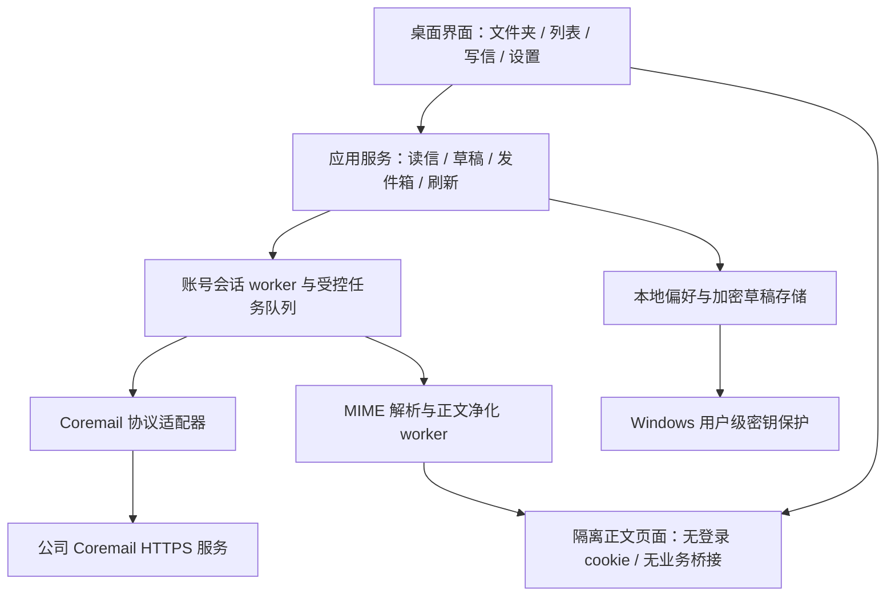
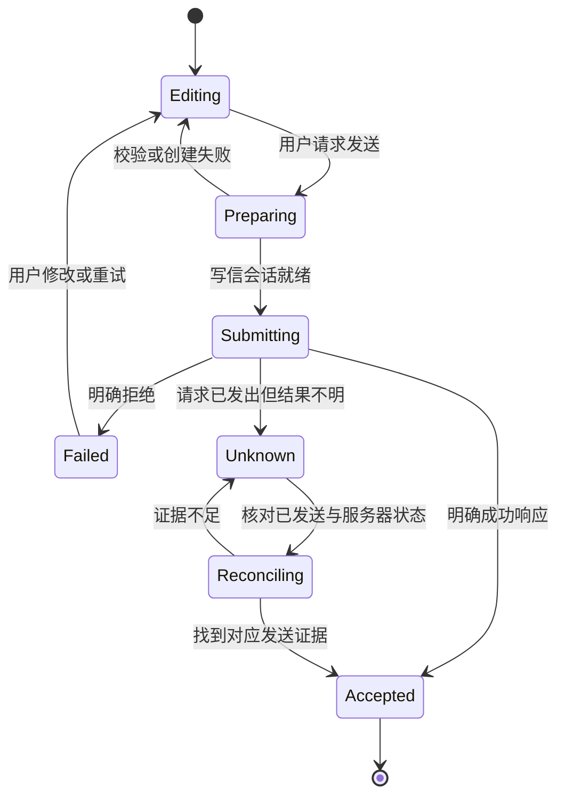

# 自研 Coremail 邮箱客户端设计文档

版本：0.1（评审稿）  
日期：2026-10-15  
适用平台：Windows 桌面  
项目目录：`D:\workspace\redocoreemail`  
状态：基础收发可行性已实测；本文定义后续产品设计，尚未进入完整客户端实现。

## 1. 目标与设计依据

目标是为个人工作邮箱开发一套可以独立运行的客户端，改善日常读信、写信、查找和处理邮件的体验，通过公司现有 Coremail 服务完成收发。最终目标是逐步覆盖日常工作所需功能。

已确认的用户要求：

- 现有 Coremail 客户端体验不佳，希望重新实现完整客户端。
- 按用户说明，公司关闭了普通 IMAP/SMTP 接入；优先研究 Coremail 使用的接口。
- 先验证独立登录与收发，再开展其他功能。
- 可以使用多个 subagent，下载所需工具或插件。
- 用户提供了个人 PFX 证书，并要求将证书加解密提前至 V0.1；开发先验证格式与互通性。

本稿采用以下默认产品选择，供用户评审：Windows 单账号优先、简体中文界面、三栏邮件工作台、键盘与鼠标均可高效操作。具体痛点尚未逐项访谈，因此“列表信息清晰、切换流畅、写信不丢稿、失败可恢复”是当前设计假设，不代表已验证的用户偏好。

成功标准是日常任务可以可靠完成：找到邮件、读懂正文、正确回复和发送、保留草稿、清楚知道操作结果。不能仅以界面完成或接口返回 HTTP 200 作为完成标准。

## 2. 已验证能力与证据边界

2026-10-15，原型用用户在本机输入的密码建立独立会话，真实完成：

| 项目 | 实测结果 |
| --- | --- |
| 登录服务器 | `https://newmail.inspur.com/coremail/` |
| 独立密码登录 | 成功，未复用浏览器或原客户端会话 |
| 文件夹 | 读取 9 个文件夹 |
| 邮件列表 | 读取 5 条邮件摘要 |
| 原始邮件 | 下载并识别 MIME 邮件，41,053 字节 |
| 发送 | 向用户自己的邮箱发送固定测试邮件 |
| 收回 | 在收件箱下载 MIME，核对 From、To、Subject 与唯一正文标记 |

证据：`analysis/connection-probe-result.json`、`analysis/收发可行性验证结果.md`。现有原型有 24 项离线回归测试。

其他边界：

- `mail.inspur.com` 当前是另一套 Outlook OWA；不能与已验证的 Coremail 入口混用。
- PFX 的私钥、密码和用途没有解析，本次普通收发没有使用证书。
- 附件上传、标记读写、移动删除、服务端搜索、增量同步、验证码及二次认证尚未完成真实兼容性验证。
- 已安装 Ghidra，但原生程序冷分析达到时限，没有取得反编译结果。后续产品不以原生反编译成功作为普通收发的前置条件。
- 当前成功结论仅覆盖本账户、服务器部署和测试环境，不自动推广到其他公司或所有 Coremail 版本。

## 3. 产品范围与版本分期

### 3.1 分期

| 阶段 | 定位 | 交付范围 | 退出条件 |
| --- | --- | --- | --- |
| P0：连接验证 | 已完成 | 独立登录、限量读取、自发自收 | 已有真实通过报告 |
| V0.1：基础图形客户端与证书加解密 | 首个产品里程碑 | 单账号登录、文件夹、分页列表、普通及证书加密邮件阅读、新建纯文本邮件、证书加密发送、回复/回复全部、转发正文、本地自动草稿、手动刷新、状态反馈 | 本节功能及第 14 节验收全部通过，包含与原客户端加解密互通 |
| V0.2：日常处理能力 | 扩展 | 普通附件下载/上传、已读未读、星标、移动到文件夹、移入废纸篓、服务端搜索、基础轮询、基础通知 | 对应协议契约逐项实测，通过恢复与一致性测试 |
| V0.3：离线与效率 | 扩展 | 可控的持久邮件缓存、离线阅读、明确范围的本地搜索、会话聚合、批量处理 | 缓存、索引、同步冲突与数据保护设计验证完成 |
| V0.4：企业能力 | 扩展 | 扩展签名工作流、证书管理与更新、组织通讯录，按实际需要加入日历 | 对应能力逐项验证 |

版本号表示范围顺序，不构成时间承诺。每个阶段完成协议验证与验收后再扩展。

### 3.2 V0.1 的明确边界

- 邮件以单封列表显示，暂不推断不可靠的会话关系。
- 回复必须保留正确的回复地址和引用关系；“转发正文”不自动携带原附件。
- 展示已有附件名称、类型和大小；实际下载、预览与上传在 V0.2 提供。
- 普通 HTML 邮件支持隔离阅读；写信先采用纯文本编辑器，富文本编辑另行扩展。
- 已读状态以服务器值显示，V0.1 不自动回写已读标记；V0.2 验证接口后提供同步切换。
- 不提供离线发信、批量自动操作、自动规则或定时发送。
- 首版支持经实际样本确认的证书加密格式；解密后的 MIME 进入相同隔离阅读流程。未知格式或解密失败显示具体状态，不能渲染成空白正文；缺失目标格式兼容性时只能发布预览版。
- 不修改原客户端安装目录，也不写入或迁移现有 `.edbx2`、`.data`、`.cmpack` 数据库和容器。

## 4. 技术方案选择

### 4.1 方案比较

| 方案 | 收益 | 代价与限制 | 结论 |
| --- | --- | --- | --- |
| Python + PySide6 / Qt Widgets + Qt WebEngine | 同语言迁移已验证传输逻辑；桌面列表、窗口、快捷键成熟；HTML 阅读可独立隔离 | 需要做界面主题、打包和 Qt WebEngine 分发验证；不能提前承诺低内存或小安装包 | **本稿建议** |
| Electron + React + Python worker | 网页界面定制能力强，复用 Python 通信 | 引入前端构建、跨进程协议、双运行时打包和生命周期管理 | 若后续用户明确偏好高度网页化界面再评估 |
| Tauri + Web UI + Rust/辅助进程 | 另一种桌面分发与网页 UI 组合 | 当前没有对应 Rust 实现；需补足 Python 辅助进程或重写协议，增加首版变量 | 暂不采用 |

这是针对当前 Python 验证成果和 Windows 单人客户端目标的工程判断，不是框架性能排名。依赖版本在实施计划中根据实际打包试验固定，本文不虚构最新版本号。

### 4.2 推荐组合

- 应用外壳、列表、表单与设置：PySide6 / Qt Widgets。
- 邮件 HTML：独立 Qt WebEngine 页面，仅负责受限正文展示。
- 业务层与协议适配：Python，按职责重构原型的已验证逻辑。
- 后台任务：受控 worker 与消息队列；UI 线程不执行网络、MIME 解析或证书操作。
- V0.1 持久化：SQLite 保存非邮件界面偏好和加密草稿索引；草稿内容独立加密保存。
- 网络：保留 HTTPS、同源边界与 CookieJar 语义；每个账号由一个会话 worker 持有会话，不在多个线程共享未经保护的 opener。

Qt 官方提供 [QWebEngineView](https://doc.qt.io/qtforpython-6/PySide6/QtWebEngineWidgets/QWebEngineView.html) 与 [QWebEngineSettings](https://doc.qt.io/qtforpython-6/PySide6/QtWebEngineCore/QWebEngineSettings.html)。正文隔离仍需实现请求拦截、导航限制和测试，不能只靠关闭 JavaScript 就宣称安全。

## 5. 系统架构



### 5.1 模块边界

| 模块 | 职责 | 不应承担的职责 |
| --- | --- | --- |
| Desktop UI | 展示数据、采集用户操作、维护焦点和视图状态 | 拼接服务器地址、管理 sid、直接读私钥 |
| Application Services | 组织读写流程、处理重试类别、管理草稿和发送状态 | 依赖 Qt 控件对象或服务器原始 JSON 字段 |
| Session Worker | 串行持有登录会话，排队请求、鉴权失效协调、超时与任务代次管理 | 在 UI 线程阻塞等待、自动重发不确定的发送请求 |
| Coremail Adapter | 登录、固定路由、参数、错误码、类型扩展与响应转换 | 决定界面文案、自动绕过服务器认证步骤 |
| MIME / Sanitizer | 解析 MIME 树、附件描述、字符集、生成受限正文 | 直接执行邮件 HTML、访问会话凭据 |
| Reader | 展示净化后的邮件，处理明确允许的资源与链接操作 | 连接业务命令通道、加载登录会话、任意访问磁盘 |
| Store / Vault | 保存偏好、加密草稿及后续受控缓存 | 将密码、cookie、sid 或证书密码写入普通日志 |
| Crypto | 本机证书解锁/锁定、格式识别、收件人证书检查、加密与解密 | 将私钥交给服务器或正文页面；缺证自动降级明文 |

业务层输出统一模型；Qt signals/slots 或等价消息只传递所需数据与任务 ID。过期 worker 结果不得覆盖当前选择的邮件。

### 5.2 现有原型的处理

保留 `probe/` 为可重复运行的实验工具及回归证据。生产适配器迁移经验证的协议行为，并保留测试，不直接把整个原型当成产品 SDK：原型的固定自收地址、固定收件箱、终端输出、简单错误码和短轮询需要与通用产品流程分开。

## 6. 信息架构与界面

### 6.1 主工作台

```text
┌──────────────────────────────────────────────────────────────────────┐
│ 写邮件    当前邮箱 / 文件夹                 搜索入口*   刷新   设置 │
├──────────────┬──────────────────────┬────────────────────────────────┤
│ 账号         │ 文件夹名  最近刷新   │ 主题                           │
│ 收件箱       │ 全部 / 未读显示筛选  │ 发件人、收件人、时间、状态      │
│ 已发送       ├──────────────────────┤ 回复  回复全部  转发正文       │
│ 草稿         │ 发件人       时间    ├────────────────────────────────┤
│ 废纸篓       │ 主题                 │ 正文阅读                       │
│ 自定义文件夹 │ 摘要 / 附件标识      │ 引用内容可展开                 │
│              │ ...                  │ 附件描述区                     │
├──────────────┴──────────────────────┴────────────────────────────────┤
│ 连接状态 / 最近成功同步时间 / 当前任务 / 可恢复错误                  │
└──────────────────────────────────────────────────────────────────────┘
* V0.1 提供当前已加载列表的本地筛选，并明确显示范围；服务端搜索在 V0.2。
```

- 1280px 以上默认三栏；建议文件夹 200–240px、列表 320–400px，阅读区占剩余宽度。分隔条可拖动并恢复默认。
- 1000–1279px 可折叠文件夹栏；更窄时列表和阅读切换，返回保持滚动和选择状态。
- 主窗口设计基准为 1280×800，最小可用窗口目标为 1000×680；验证 Windows 125%、150% 和 200% 缩放。
- 文件夹名称来自服务器，统一模型保存角色映射；不要根据中文名称猜测服务器 ID，也不要把原型中的 fid=0 当作所有部署的永久规则。
- 列表行包含发件人、主题、时间、短摘要与附件标识；敏感内容的桌面通知默认不展示正文。
- 筛选切换不触发邮件状态写入。选择邮件后先显示缓存摘要，再加载正文；加载失败不清空原列表。

### 6.2 视觉规范

方向为清晰、克制的办公工具：浅色底、细分隔线、单一主操作色，避免大面积渐变和装饰动画。

| 语义 | 浅色建议 | 深色建议 |
| --- | --- | --- |
| 应用背景 | `#F6F8FB` | `#111827` |
| 内容表面 | `#FFFFFF` | `#1F2937` |
| 主要文字 | `#172033` | `#F3F4F6` |
| 次要文字 | `#526078` | `#B8C2D3` |
| 主操作 | `#2563EB` | `#60A5FA` |
| 危险操作 | `#B91C1C` | `#FCA5A5` |

这些是初始语义色板，按钮文字与背景需分别校验对比度。使用系统字体（Microsoft YaHei UI / Segoe UI 回退），不依赖在线字体。正文默认 16px 等效字号，列表可切标准与紧凑密度；文本缩放不改变内容结构。

图标采用一致线条风格，关键按钮有文本或可访问名称。焦点始终可见，状态不能只靠颜色。动效只用于表达状态变化，目标 100–180ms，并尊重减少动态效果设置。

### 6.3 快捷键

| 操作 | 默认 |
| --- | --- |
| 新建邮件 | Ctrl+N |
| 当前列表筛选 / 后续全局搜索 | Ctrl+K，界面明确当前作用范围 |
| 刷新当前文件夹 | F5 |
| 保存当前草稿 | Ctrl+S |
| 请求发送 | Ctrl+Enter，进入同一发送检查流程 |
| 正文内查找 | Ctrl+F |
| 关闭当前面板 / 取消非提交任务 | Esc |
| 邮件列表导航 | 上下键；Enter 打开，返回恢复原位置 |

不采用在文本输入框内也触发的单字母全局快捷键。

## 7. 核心用户流程

### 7.1 登录与会话失效

1. 展示服务器、账号与密码输入框；密码允许粘贴，默认不持久保存。
2. 建立本应用自己的登录会话，完成已验证的表单与同源应用入口跳转。
3. 以已认证接口成功作为登录成功证据，进入工作台。
4. 服务端返回验证码、二次认证或设备绑定要求时，展示可理解的状态；只有对应挑战流程验证并实现后才能继续，否则提供在原客户端处理的路径。
5. 鉴权失效时停止新的修改操作，保留编辑内容，合并为一次重新登录提示；不会让多个 worker 同时弹出密码框。

网络超时、无法解析部署响应、密码拒绝、认证挑战应分别映射；不要重复原型早期把“未识别跳转”笼统显示为二次认证的做法。

### 7.2 阅读与筛选

进入文件夹 → 分页读取摘要 → 用户选择邮件 → 下载 MIME → 后台解析与净化 → 展示正文和附件描述。切换邮件后旧请求可结束，但其结果只能进入缓存，不能覆盖新邮件。

V0.1 列表筛选只覆盖已加载邮件，并持续显示“筛选已加载的 N 封”。零结果不能表述为“邮箱没有这封邮件”。服务端搜索未接入前不提供伪装成全量搜索的入口。

### 7.3 写信、回复与草稿

写信窗口包含收件人、抄送/密送折叠项、主题、纯文本正文、草稿状态和发送状态。初期同一主窗口同时维护一个编辑会话；未保存内容不得因切换邮件丢失。

- 新建、回复、回复全部与转发正文使用独立的本地草稿 ID。
- 回复使用 Reply-To 优先于 From 的地址语义；回复全部去重并排除当前账号的已确认身份集合。
- 保留 In-Reply-To / References，避免仅靠“Re:”主题制造回复关系。
- 转发正文清楚标注原信来源；不宣称已经转发原附件。
- 输入停止约 1 秒后保存本地草稿，Ctrl+S 立即保存；界面显示“已保存到本机”与时间，不能显示为服务器草稿已同步。
- 退出或崩溃后允许恢复加密本地草稿；保存失败时持续提示，不以短暂 toast 掩盖。

回复语义和额外头字段属于 V0.1 上线前必须验证的协议契约，不能仅由原型新信发送成功推导已完成。

### 7.4 发送与重复发送控制

发送前校验地址、主题为空提示及当前会话状态。冻结本轮发送快照，建立服务器写信会话，提交发送。连续点击和快捷键只能产生一个提交任务。



“服务器已接受”“已保存到已发送”“已送达收件人”是不同状态。普通对外邮件在没有回执证据时只显示可证明的状态；本次原型的自收检查不等于通用投递回执能力。

调用 deliver **之前**，必须把本地发送 ID、冻结草稿版本、完整发送快照、composeId 与 Submitting 状态作为同一份加密权威记录原子持久化，并确认落盘成功；持久化失败时不能提交。辅助索引可重建，不能作为唯一的崩溃恢复依据。

当提交后的连接中断，不自动重放 deliver。重启发现遗留 Submitting 记录时，一律转为 Unknown，显示“发送结果待确认”，先核对后提供人工重发路径；不能直接还原成普通可再次发送的草稿。确认服务器接受后，再持久化 Accepted 状态。服务器 composeId 不能被假定为具备幂等保证。

## 8. 协议适配与兼容性

| 能力 | 当前依据 | 产品接入要求 |
| --- | --- | --- |
| 密码登录 | 已真实验证表单 POST + 同源 JS 入口跳转 | 保留独立会话与失败分类；只解析受限字面量跳转，不执行任意脚本 |
| 文件夹 | 原型 `mbox:getAllFolders` 成功 | 转换统一 Folder 模型，验证系统文件夹角色 |
| 列表 | 原型 `mbox:listMessages` 成功 | 分页、去重、稳定选择；边界和异常响应测试 |
| 原始 MIME | `mbox:getMessageData`、mode=text 已真实验证 | 大小限制、字符集、错误页面识别、后台解析 |
| 普通新信 | compose JSP 的 continue → deliver 已真实验证 | 生产发件状态机、重复提交控制、已发送核对 |
| 回复/转发 | 公开脚本及静态接口线索 | 新建测试邮件实测引用关系和正确收件人后启用 |
| 状态写入/移动/删除/搜索 | 现有静态或脱敏日志线索 | V0.2 独立验证请求、结果、恢复语义后启用 |
| 附件/加密/证书 | 安装资源与格式线索 | 分别取得正常样本验证，不能据文件扩展名声称兼容 |

协议层限定部署 origin 与业务路由，结构化序列化参数。将 Coremail 扩展日期转换为带来源时区的模型字段；缺失时区不默认为 UTC。适配器记录能力表和部署版本证据，不能以一次解析失败自动尝试其他登录接口、绕过挑战或放宽 TLS。

对稳定只读请求可执行有限重试：最多 2 次额外尝试，指数退避并加入抖动；认证拒绝、参数错误和写操作不自动重试。网络读取、解析与写操作使用不同的任务状态。

## 9. 数据模型与本地存储

### 9.1 模型

| 实体 | 关键字段 |
| --- | --- |
| Account | local_id、server_origin、login_uid、verified_identities、capabilities |
| Folder | account_id、remote_id、name、parent_id、role、counts、last_refreshed_at |
| MessageSummary | account_id、remote_id、folder_id、Message-ID、from/to 摘要、subject、date、flags、attachment_count |
| MessageContent | message_key、raw_digest、MIME 树、text_body、sanitized_html、附件描述 |
| Draft | local_id、reply_context、recipient_sets、subject、body、revision、saved_at |
| SendJob | local_id、draft_revision、compose_id、state、submitted_at、reconciliation_evidence |

Message-ID 可能缺失或重复，不单独作为本地唯一键。基础键使用 account_id + remote_id；跨文件夹移动后是否改变 remote_id 需要实测，不提前假定。

### 9.2 V0.1 存储策略

- 邮件摘要和正文采用有界内存缓存，关闭后重新从服务器读取；正文 LRU 初始预算 128 MiB，可配置。
- 本地持久保存界面偏好、账号显示配置和加密草稿/发送意图；账号标识也按个人数据处理。
- 草稿和发送意图的内容与附件路径等敏感字段用 Windows 用户级 DPAPI 保护后写入文件；索引只保存不含主题、地址、正文的本地 ID、版本与状态。
- 密码、sid、cookie 与 PFX 密码仅在会话内使用。Python 不保证清零所有字符串副本，因此不声称“内存不可恢复”。
- 默认不做“记住密码”；后续如需要，单独设计 Windows 凭据存储与账号退出语义。

DPAPI 的用户上下文保护机制见 [Microsoft CryptProtectData 文档](https://learn.microsoft.com/en-us/windows/win32/api/dpapi/nf-dpapi-cryptprotectdata)。它提供本地数据保护，不能代替终端防护，也不能承诺抵御已控制当前用户会话的程序。

### 9.3 V0.3 离线缓存决策

持久邮件缓存是独立阶段。可采用文件级内容加密和受保护密钥，但必须处理检索索引泄漏问题：普通 SQLite FTS5 的词项与片段会包含邮件信息。未完成索引保护方案前，不声称“邮件与全文索引均已加密”，也不默认建立完整正文索引。

原 Coremail 数据目录仅作为研究证据保留。首版不导入原客户端的 5.56GB 归档容器，不依赖解密其数据库才能运行新产品。

## 10. 同步与多端一致性

- V0.1：手动刷新，分页拉取。切换文件夹保持已有列表与滚动位置，刷新结果按 remote_id 合并，避免整页闪烁。
- V0.2：前台默认 60 秒轮询；连续失败退避到最长 5 分钟。这只是调度设计，实际轮询频率需结合服务器响应和使用要求调整。
- 没有验证推送或增量游标前，不能宣称实时推送或完整增量同步。
- 不同 worker 返回带账号 ID、任务 ID、视图代次与请求时刻的结果；忽略过期结果。
- 多端状态以服务器为准；界面可乐观展示的写操作必须有回滚与失败可见性。
- 对每次同步保存成功时间与覆盖范围。“本次刷新 50 封”不能显示为“全部邮件已同步”。

## 11. 邮件正文与附件的隔离

邮件正文属于外部输入，需要隔离于应用业务界面：

1. MIME 解析和 HTML 净化在后台执行，设定原始消息大小、解码后总量和 MIME 深度上限；超限保留摘要并说明原因。
2. 移除脚本、事件属性、表单、iframe/object/embed、危险 URL 与可触发外连的 CSS 等内容；净化后再渲染。
3. 正文页面不挂载 QWebChannel 或其他业务桥接，不拥有登录 CookieJar，不加载应用配置或密钥。
4. 默认阻断网络和任意本地文件请求；CID 内嵌图片通过受控资源映射提供，不允许以 file:// 直接访问任意路径。
5. 远程图片默认不加载，用户对当前邮件明确选择后才下载；下载器使用独立无认证会话，不能带上 Coremail sid、cookie 或身份头。
6. 正文外链通过显式点击交给系统浏览器；限制协议，显示可理解的目标，不在正文中执行应用命令。
7. 附件在 V0.2 才能保存：清理文件名、拒绝路径穿越、避免静默覆盖，不自动执行；预览另做格式和大小限制。

产品正文渲染与认证挑战页面不得共用带特权的业务通道。若后续接入可交互认证页面，需单独设计认证容器与完成信号，不把普通正文视为认证页面。

## 12. 证书与加密邮件

用户提供的 `D:\证件\王标-certificate.pfx` 是证书研究入口，产品配置采用用户选择文件，不把该路径硬编码进安装包。

2026-10-15 优先级调整：本模块从 V0.4 提前到 V0.1。先做本机兼容性验证，再实现读取和发送；普通邮件开发可并行，但完整 V0.1 发布必须通过加解密验收。

接入分为四步：

1. 在本机输入证书密码后读取公开证书属性，确认主体、邮箱身份、用途、有效期与证书链；区分签名、解密、客户端认证。
2. 通过真实邮件 MIME 类型和样本确认格式，例如标准 S/MIME 或企业扩展，不能把所有 `.enc` 当作 S/MIME。
3. 优先验证原客户端生成的加密测试邮件可在新实现解密，以及新实现加密后原客户端可解密。自加密往返仅作单元验证，不能代替互通证据。遇到签名封装时正确处理并分别显示签名数学验证与证书信任结果；独立签名发送工作流后续扩展，实际格式要求签名时首版一并实现。
4. 客户端展示签名有效性、证书身份与解密状态，不把“可以解密”与“签名可信”混为一谈。

证书密码默认不保存，私钥不上传服务器、不导出到普通临时文件。是否使用原 PFX、Windows 证书存储或其他本机密钥设施，在前置兼容性试验中选择成熟密码实现并固定依赖；不自行实现密码算法。

加密发送需验证每位 To/Cc/Bcc 收件人的公钥证书、邮箱绑定、用途、信任及有效性；首版允许用户显式选择收件人公开证书，不依赖尚未实现的组织目录。保留发件人解密副本，并验证密送地址不泄露到可见邮件头或普通收件人可读正文。缺证、证书不合格或算法不支持时阻止加密发送，不能静默改成明文。格式本身的收件人元数据暴露特性须在兼容性报告中说明。

协议适配必须验证原始加密 MIME 或企业加密载荷的提交路径，不假设现有普通正文 compose 接口会原样保留信封。加密最终载荷在提交前冻结，纳入既有持久化发送意图和 Unknown 恢复机制。回复/转发已解密邮件默认保持加密要求，发送前显式展示收件人证书检查，不自动明文发送解密内容。

解密正文仅在会话内存中用于阅读，不额外写出临时明文或正文缓存；草稿仍按第 9 节保护。证书锁定/账号退出时释放密钥引用、清除已解密视图及缓存，不声称 Python 内存可彻底清零。正文渲染容器不能访问 PFX、私钥或密码。

## 13. 错误、日志与诊断

错误模型至少区分：网络不可达、TLS 失败、认证被拒绝、认证交互要求、会话过期、响应结构不兼容、正文解析失败、草稿保存失败、发送明确拒绝、发送结果不明。

日志默认记录本地操作 ID、能力名、阶段、耗时、响应类别和重试次数。不记录密码、cookie、sid、完整请求 URL、认证头、证书密码、正文或原始响应。

协议诊断按字段名、类型与结构生成；输出前检查动态路径和 query 中的身份信息，不以“没记录密码”作为已充分脱敏的标准。用户导出诊断包前可检查包含范围，普通运行不采集整份个人邮箱日志。

## 14. 验收与测试设计

### 14.1 V0.1 必须通过

| 类别 | 验收场景 | 完成条件 |
| --- | --- | --- |
| 独立认证 | 新启动应用，输入密码 | 不依赖既有客户端/浏览器会话，已认证接口成功 |
| 认证异常 | 错误密码、会话失效、未知挑战 | 清楚分类并停止无意义重试，编辑内容不丢失 |
| 列表 | 文件夹切换、连续分页、刷新 | 不重复，不因旧响应覆盖新选择；不把部分数据称为全量 |
| 普通阅读 | 中文/英文、纯文本、HTML、multipart、CID | 正文可读，编码正确，外部内容不能调用业务命令 |
| 证书与解密 | 本地 PFX 解锁、错误密码、证书不匹配、未知算法、原客户端加密样本 | 正确解密并隔离展示；错误明确；私钥及解密正文不落普通临时文件 |
| 加密发送互通 | 自发自收、To/Cc/Bcc 证书检查、缺证、原客户端收件 | 双向互通通过；缺证不降级明文；密送可见性正确；发送不绕过持久化状态机 |
| 写信 | 新建、回复、回复全部、转发正文 | 收件人正确，回复引用关系正确，无静默丢稿 |
| 草稿 | 编辑后退出、崩溃与保存失败 | 可恢复已保存版本；失败可见；磁盘无明文主题/正文 |
| 发送 | 新信与回复、自发自收 | 明确发送状态，收件箱 MIME 核对通过 |
| 防重复 | 连点发送、发送后超时，以及 deliver 前后/Accepted 落盘前强制崩溃 | 未落盘不提交；遗留 Submitting 恢复为 Unknown；不并发重复提交、不自动重发 |
| 显示与键盘 | 125–200% 缩放、仅键盘操作 | 无关键按钮遮挡，焦点可见，Tab 与快捷键无冲突 |
| 保密边界 | 诊断与正文恶意内容样本 | 日志无凭据或正文；正文不能访问会话/本地任意文件 |

V0.2 起补充附件、状态变更、搜索范围与同步冲突的独立测试。测试不读取或修改与场景无关的公司数据；可产生邮件的集成测试使用明确的测试收件人和内容。

### 14.2 性能目标（设计预算）

这些指标尚未测量，需要在同一台用户机器和固定样本下记录：

- 点击、选择和键盘操作在 100ms 内提供视觉反馈；网络完成时间另计。
- 缓存邮件切换目标 P95 小于 200ms；首次正文另显示加载状态与服务器耗时。
- UI 主线程不等待网络，不批量解析完整邮箱；单次列表分页默认 50 条。
- 具备 1,000 条已加载摘要时采用虚拟列表，保持滚动和选择可用。
- 启动、空闲内存、HTML 阅读和打包体积建立基线，再决定预算；不预先宣称“比官方客户端更轻”。

## 15. 分发与维护

- 应用数据使用本客户端独立目录，安装包不附带个人邮箱、PFX、日志或研究时的服务器会话。
- Ghidra、REA、原始安装包和研究证据不是最终客户端运行依赖，不打进客户端安装包。
- V0.1 先提供可回退的 Windows 构建；干净用户环境验证 Qt WebEngine 资源、系统字体和运行时依赖。
- 依赖版本、许可证与安装方式在构建时固定并记录。界面、协议适配和本地存储模式各有版本标识。
- 协议兼容性变化先影响对应能力；禁用失败能力并展示原因，保留已保存草稿。
- 第一期不自动安装更新；后续自动更新需另行设计签名校验、失败回滚和迁移策略。

## 16. 当前决策与评审重点

本稿建议采用以下组合进入下一阶段规划：

1. Python + PySide6 桌面应用，Qt WebEngine 隔离阅读 HTML。
2. Windows 单账号优先，三栏工作台；纯文本写信先行。
3. V0.1 包含普通读写、回复、本地草稿及证书加解密，V0.2 接入附件及邮箱管理。
4. 先保持在线工作模式，持久邮件缓存与全文搜索独立设计。
5. PFX 与真实加密邮件格式验证先行；加密发送、解密阅读及原客户端互通列为首版发布条件。

用户评审时重点检查：技术路线是否符合长期目标、V0.1 是否覆盖最重要任务、附件是否必须提前、界面布局与默认中文是否合适。这些是本稿建议的可调整决策；批准文档后再形成详细实施计划，不把本稿当作已经完成的产品能力。

## 17. 关联材料

- `analysis/收发可行性验证结果.md`：本次真实连接与收发证据。
- `analysis/connection-probe-result.json`：最终 passed 结果。
- `analysis/protocol-feasibility.md`：接口契约、公开脚本锚点和未验证能力。
- `analysis/客户端整体结构梳理.md`：原客户端结构。
- `analysis/邮件存储结构.md`：原存储的观察与格式边界。
- `analysis/native-auth-status.md`：原生冷分析超时与清理结果。
- `README.md`、`probe/`、`tests/`：连接验证工具与回归测试。

以上路径均相对于项目根目录。本文不包含可用会话凭据或证书私钥。
